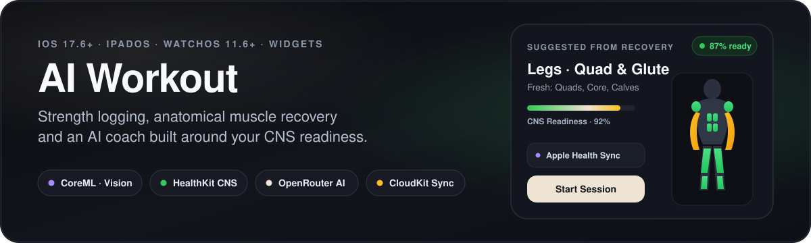
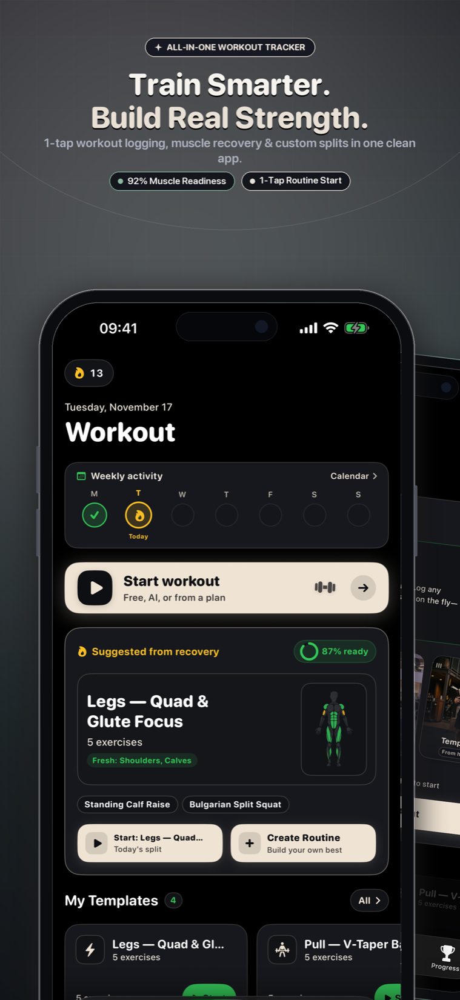
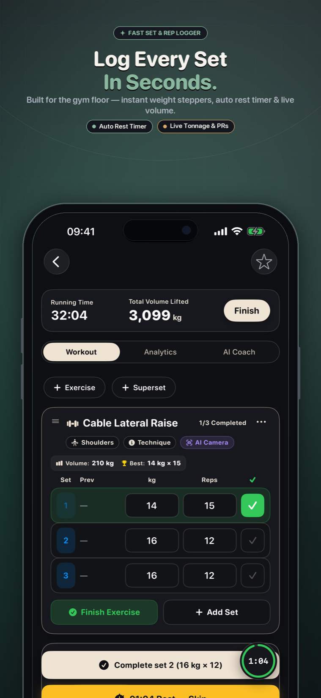
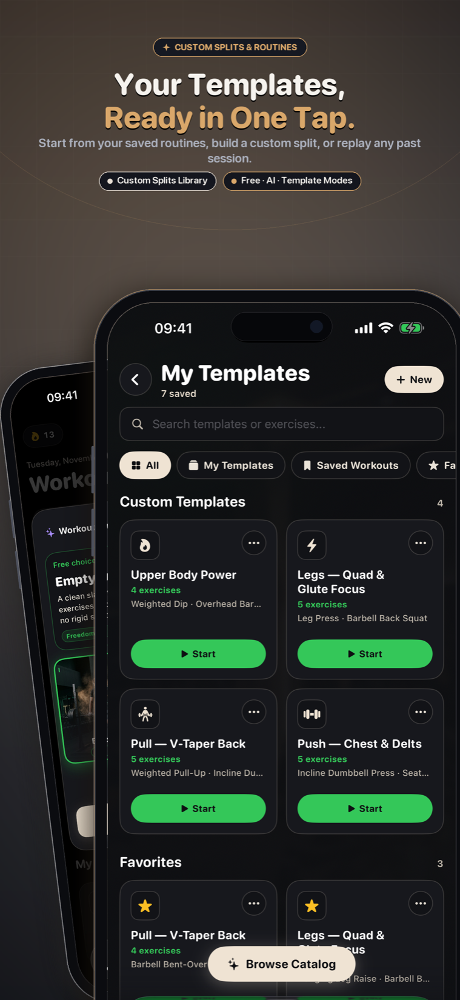
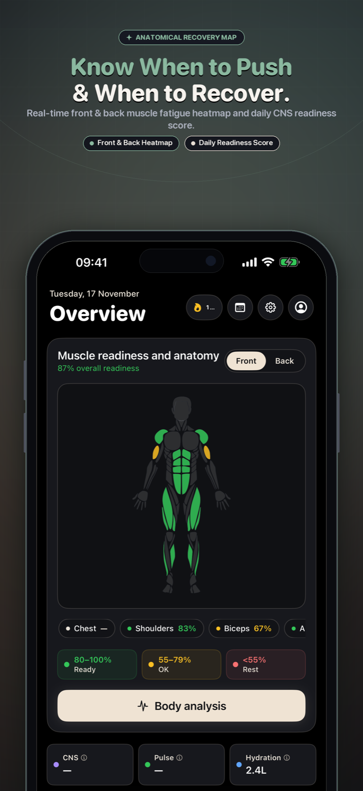
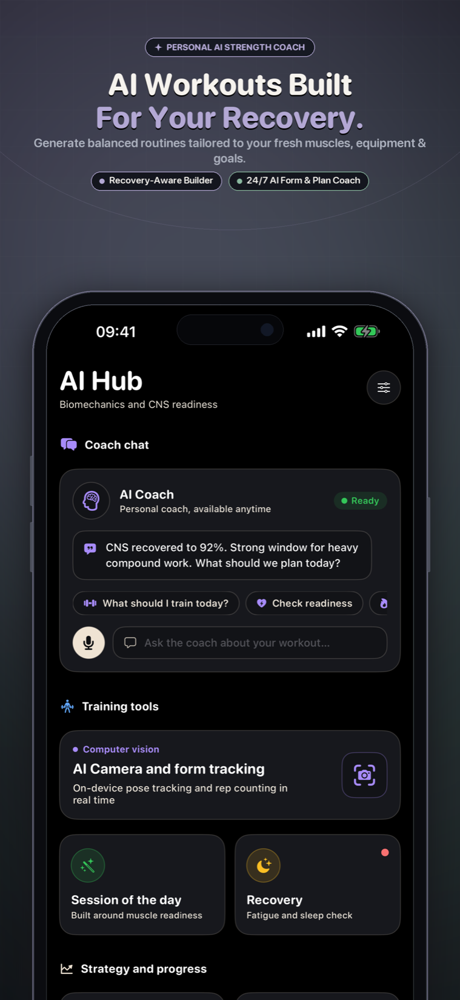
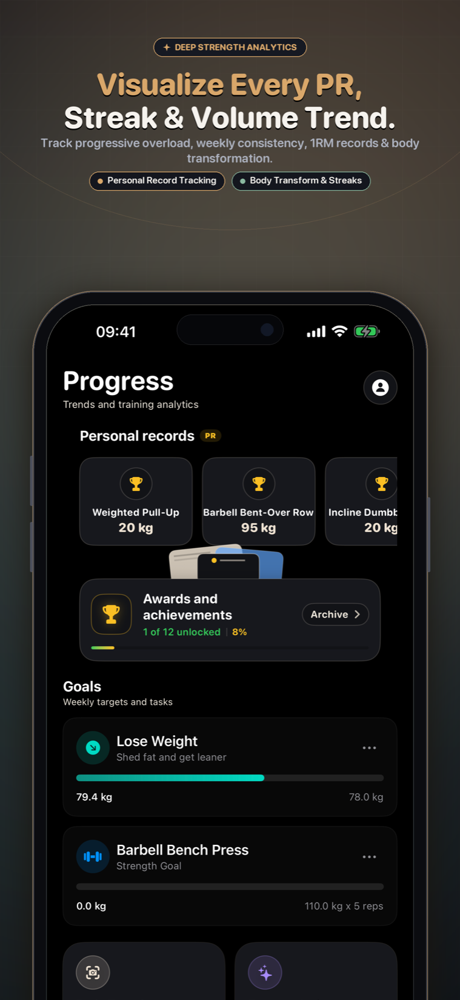
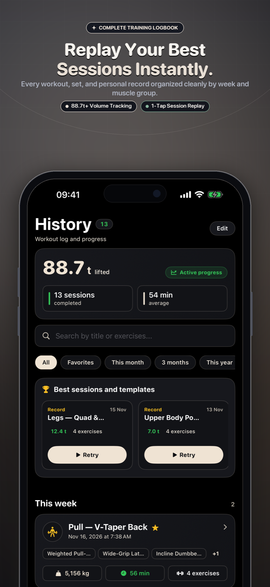
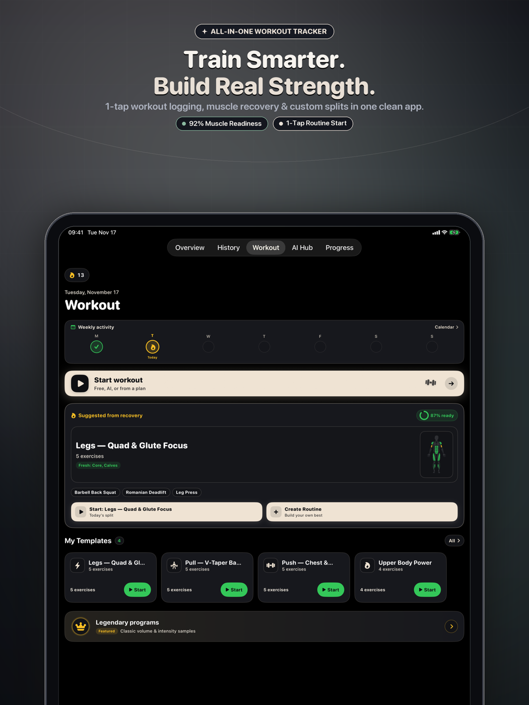

<div align="center">


<h1>AI Workout</h1>

<p><strong>AI Workout Coach &amp; Gym Tracker for iPhone, iPad &amp; Apple Watch</strong></p>

<p>
  <a href="https://apps.apple.com/us/app/ai-workout-coach-gym-tracker/id6774895106">
    
  </a>
</p>

<p>
  <a href="https://apps.apple.com/us/app/ai-workout-coach-gym-tracker/id6774895106">
    
  </a>
</p>

<p>
  <a href="https://apps.apple.com/us/app/ai-workout-coach-gym-tracker/id6774895106"><strong>App Store</strong></a>
  ·
  <a href="https://borisserz.github.io/workouttracker-privacy/support.html"><strong>Support</strong></a>
  ·
  <a href="https://borisserz.github.io/workouttracker-privacy/"><strong>Privacy Policy</strong></a>
  ·
  <a href="https://borisserz.github.io/workouttracker-privacy/eula.html"><strong>EULA</strong></a>
  ·
  <a href="https://apps.apple.com/us/developer/barys-serzhanovich/id6774895109"><strong>More Apps</strong></a>
</p>

</div>

---

**AI Workout** is a native SwiftUI & SwiftData training platform designed around a dark-first **Pastel OLED** interface. It pairs 1-tap set logging and Apple Watch companion tracking with HealthKit CNS readiness, an anatomical muscle recovery heatmap, on-device CoreML/Vision rep counting, and an AI strength coach backed by Firebase App Check and OpenRouter.

---

## Screenshots

<div align="center">

<table>
  <tr>
    <td align="center" width="25%">
      <br>
      <sub><strong>Workout Hub</strong><br>Streak, recovery split &amp; templates</sub>
    </td>
    <td align="center" width="25%">
      <br>
      <sub><strong>Live Logger</strong><br>Instant sets, supersets &amp; rest ring</sub>
    </td>
    <td align="center" width="25%">
      <br>
      <sub><strong>Templates &amp; Splits</strong><br>Custom routines &amp; 1-tap launch</sub>
    </td>
    <td align="center" width="25%">
      <br>
      <sub><strong>Muscle &amp; CNS</strong><br>Front/back heatmap &amp; readiness</sub>
    </td>
  </tr>
</table>

<table>
  <tr>
    <td align="center" width="33%">
      <br>
      <sub><strong>AI Coach &amp; Vision</strong><br>Plan builder &amp; on-device form check</sub>
    </td>
    <td align="center" width="33%">
      <br>
      <sub><strong>Progress &amp; PRs</strong><br>1RM records, goals &amp; awards</sub>
    </td>
    <td align="center" width="33%">
      <br>
      <sub><strong>Training Logbook</strong><br>Volume stats &amp; 1-tap replay</sub>
    </td>
  </tr>
</table>

<p>
  <br>
  <sub><strong>iPadOS Native Layout</strong> — Full-screen navigation bar, recovery split card &amp; multi-column templates</sub>
</p>

</div>

---

## Key Capabilities

| Area | Details |
| --- | --- |
| **Workout Hub & Fast Logger** | Weekly activity ring, 1-tap start for empty sessions, recovery-suggested splits, supersets, custom weight/rep steppers, automatic rest timer, and certified receipt share cards |
| **Muscle & CNS Recovery** | Front/back anatomical heatmap with 48–96h fatigue decay, Apple Health (`HealthKit`) integration for heart rate, HRV, resting HR, sleep, and daily CNS readiness scoring |
| **AI Coach & Workout Builder** | Context-aware AI coach chat, multi-day split generator, mid-workout swaps, and voice commands (`Speech` + microphone). Non-sensitive training context only — body weight and Apple Health metrics are never sent to AI models |
| **On-Device Vision & CoreML** | Real-time pose tracking, rep counting, and exercise recognition powered by Apple `Vision` and custom `WorkoutClassifier.mlmodel` completely on-device |
| **Apple Watch & Widgets** | Companion watchOS app (`WorkoutTrackerWatch Watch App`) with `HKWorkoutSession` & `WatchConnectivity`, Dynamic Island & Lock Screen Live Activities (`WorkoutTimerWidgetExtension`), and Home/Lock Screen widgets (`StatsWidgetExtension`) |
| **Cloud Sync & Community Safety** | Private user sync via Apple **CloudKit** (`iCloud.com.borisdev.WorkoutTracker`), deep-link/QR template sharing (`workouttracker://`) with automated OpenRouter moderation, per-reporter deduplicated abuse reports, user blocking, JSON/CSV export, and full **Sign in with Apple** token revocation on account deletion |
| **Localization** | Complete UI and exercise catalog (`exercises*.json`) in **7 languages**: English (`en`), Russian (`ru`), German (`de`), Spanish (`es`), French (`fr`), Italian (`it`), and Portuguese (`pt-PT`) |

---

## Architecture & Targets

| Target / Service | Bundle ID / Role | Details |
| --- | --- | --- |
| **`WorkoutTracker`** | `com.borisdev.WorkoutTracker` | Main iOS / iPadOS app (`17.6+`), SwiftUI, `@Observable`, SwiftData + private CloudKit |
| **`WorkoutTrackerWatch Watch App`** | `com.borisdev.WorkoutTracker.watchapp2026` | Standalone watchOS (`11.6+`) workout tracker & live HR/calories sync |
| **`StatsWidgetExtension`** | `com.borisdev.WorkoutTracker.statswidget2026` | `ProStreakWidget`, `AICoachWidget`, `QuickActionsWidget` via App Group |
| **`WorkoutTimerWidgetExtension`** | `com.borisdev.WorkoutTracker.WorkoutTimerWidget` | `ActivityKit` Live Activities & Dynamic Island rest countdown |
| **Firebase Backend (`functions/`)** | `serzhanovich-ecosystem-ce700` | Node 22 Cloud Functions v2 (`vertexProxy` via OpenRouter, `moderateSharedWorkout`, `onReportCreated`, `deleteAccount`) protected by App Check (`AppAttest`), Firebase Auth, and Firestore Rules |

### Tech Stack

- **Apple Frameworks:** `SwiftUI` · `SwiftData` · `Observation` · `CloudKit` · `HealthKit` · `Vision` · `CoreML` · `Speech` · `WatchConnectivity` · `WidgetKit` · `ActivityKit` · `AppIntents` · `Swift Charts`
- **Cloud & AI:** Firebase Auth (Anonymous, Sign in with Apple, Google Sign-In) · App Check (`AppAttest`) · Firestore · Cloud Functions v2 · Remote Config · Crashlytics · OpenRouter AI proxy
- **Testing:** `146` XCTest unit & honesty checks (`WorkoutTrackerTests`), Node `node --test` backend suite (`functions/index.test.js`), and Maestro E2E flows (`.maestro/`)

---

## Build & Verify Locally

Requires **Xcode 26.2+** (with **iOS 26.x** & **watchOS 26.2** platforms installed), deployment targets **iOS 17.6+** and **watchOS 11.6+**.

```bash
git clone https://github.com/Borisserz/WorkoutTracker.git
cd WorkoutTracker
```

1. Open `WorkoutTracker.xcodeproj` in Xcode (all AI requests route through the Firebase Cloud Functions proxy in `ai_proxy_url` — no OpenRouter/AI secret keys live in the iOS client).
2. Configure your Apple Developer Team and App Group (`group.com.borisdev.WorkoutTracker`) across `WorkoutTracker`, `WorkoutTrackerWatch Watch App`, and `StatsWidgetExtension` if building with your own signing identity.
3. Run tests or build via CLI:

```bash
# Run all iOS unit & honesty tests
xcodebuild -scheme WorkoutTracker \
  -destination 'platform=iOS Simulator,name=iPhone 17 Pro Max' \
  -configuration Debug test -only-testing:WorkoutTrackerTests

# Run Firebase Cloud Functions tests
cd functions && node --test index.test.js
```

For architecture notes, design system rules, and audit history, see [`AGENTS.md`](AGENTS.md) and [`docs/INDEX.md`](docs/INDEX.md).

---

## License

Copyright (c) 2026 Boris Serzhanovich. All rights reserved.

Portfolio and demonstration repository. Source code, UI, brand assets, and custom anatomy graphics are proprietary — no public commercial use, redistribution, or modification without written permission.
